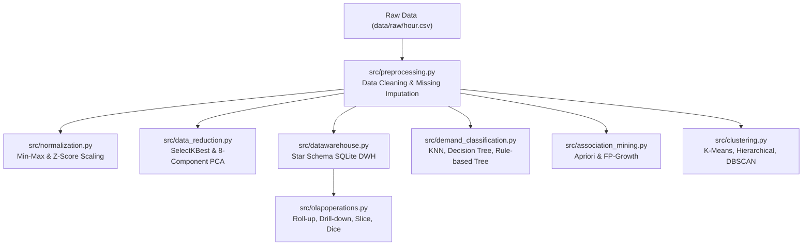

# Bike-Sharing Demand Analysis, Data Warehousing & Usage Segmentation

[](https://www.python.org/)
[](https://scikit-learn.org/)
[](#)

An end-to-end Data Warehousing and Data Mining (DWM) project analysing the **UCI Bike Sharing Dataset** (Capital Bikeshare, Washington D.C., 2011–2012). The system investigates rental demand patterns across temporal and meteorological dimensions, implements a Star Schema data warehouse with OLAP query capabilities, classifies hourly demand, mines co-occurring patterns with association rules, and clusters daily rental profiles.

Developed for **Data Mining and Warehousing (24CS552) - Activity 2**, Department of Computer Science & Engineering, **Malnad College of Engineering, Hassan** (Autonomous Institution under VTU).

---

## 👥 Authors (Team 10)
* **Rahul Kapse** (4MC24CS153)
* **Poornachandra C V** (4MC24CS141)
* **Nuthan B M** (4MC24CS135)
* **Poorvik N Gowda** (4MC24CS147)

**Faculty Mentor:** Mr. Ravi Kumar D, Assistant Professor, Department of CSE

---

## 📌 Project Architecture



---

## 📂 Repository Structure

```text
├── data/
│   └── raw/                           # Raw UCI Bike Sharing dataset
│       ├── hour.csv                   # 17,379 hourly records
│       ├── day.csv                    # 731 daily aggregated records
│       └── Readme.txt                 # Dataset description & attribute keys
├── src/                               # Source code modules
│   ├── preprocessing.py               # Missing value checks, deduplication & cleaning
│   ├── normalization.py               # Min-Max [0, 1] scaling & Z-Score standardization
│   ├── data_reduction.py              # SelectKBest feature selection & 95% variance PCA
│   ├── datawarehouse.py               # Star schema data warehouse builder (SQLite)
│   ├── olapoperations.py              # OLAP queries (Roll-up, Drill-down, Slice, Dice)
│   ├── demand_classification.py       # Multi-class demand prediction (KNN, DT, Rule-based)
│   ├── association_mining.py          # Frequent pattern mining (Apriori vs FP-Growth)
│   └── clustering.py                  # Daily profile segmentation (K-Means, Agglomerative, DBSCAN)
├── outputs/                           # Generated tables, warehouse DB, and CSV exports
│   ├── bike_sharing_warehouse.db      # SQLite Star Schema Warehouse
│   ├── cleaned_bike_sharing.csv       # Cleaned hourly dataset
│   ├── minmax_normalized.csv          # Min-Max normalized features
│   ├── zscore_normalized.csv          # Z-score standardized features
│   ├── selected_attributes.csv        # Top 5 predictive features + target
│   ├── pca_reduced.csv                # 8 principal components + target
│   ├── olap_rollup.csv                # Aggregated seasonal totals
│   ├── olap_drilldown.csv             # Month-hour granular rental counts
│   ├── olap_slice.csv                 # Single-season slice
│   ├── olap_dice.csv                  # Sub-cube multidimensional view
│   ├── classification_comparison.csv  # Accuracy, Precision, Recall, F1
│   ├── apriori_frequent_itemsets.csv  # Mined frequent itemsets
│   ├── apriori_association_rules.csv  # Association rules by confidence and lift
│   ├── fpgrowth_association_rules.csv # FP-Growth rule verification
│   ├── association_algorithm_comparison.csv # Apriori vs FP-Growth execution metrics
│   ├── daily_clustering_results.csv   # Cluster labels assigned to all 731 days
│   ├── kmeans_cluster_summary.csv     # Daily profile characteristics per cluster
│   └── clustering_comparison.csv      # Silhouette scores & noise count
├── figures/                           # Visualizations & plots (1.jpeg - 15.jpeg)
├── docs/                              # Project documentation
│   ├── TEAM_10 report.pdf             # Comprehensive 18-page formal academic report
│   └── problem statement.png          # Course problem specification sheet
├── run_pipeline.py                    # Master script to execute all steps sequentially
├── requirements.txt                   # Python package dependencies
├── .gitignore                         # Standard Git ignore rules
└── README.md                          # Project documentation
```

---

## 🔍 Modules & Methodology

### 1. Exploratory Data Analysis & Preprocessing
* Checked 17,379 records for missing values and duplicates (0 found).
* Observed dual-peak commuter usage at **08:00** and **17:00–18:00** on working days, compared to a single broad afternoon peak on weekends/holidays.
* Discovered strong collinearity between ambient temperature (`temp`) and feeling temperature (`atemp`) with $r = 0.9877$.

### 2. Data Transformation & Reduction
* **Normalization:** Computed both **Min-Max** $[0, 1]$ and **Z-Score** $(\mu=0, \sigma=1)$ for continuous weather attributes (`temp`, `atemp`, `hum`, `windspeed`).
* **Feature Selection:** Used `SelectKBest` ($F$-regression) to select top 5 features: `season`, `hr`, `temp`, `atemp`, and `hum`.
* **PCA:** Retained 95% total explained variance, reducing the feature space to 8 principal components.

### 3. Data Warehouse & OLAP Operations
Designed and populated a **Star Schema** in SQLite (`bike_sharing_warehouse.db`):
* **Fact Table:** `Fact_Bike_Demand` (17,379 rows: `casual`, `registered`, `total_demand`, foreign keys)
* **Dimension Tables:** `Dim_Time` (17,379 rows), `Dim_Season` (4 rows), `Dim_Weather` (9,278 rows)
* **OLAP Executions:**
  * **Roll-up:** Seasonal demand totals (Fall: 1,061,129 vs. Spring: 471,348).
  * **Drill-down:** Granular month $\times$ hour rental patterns (288 groups).
  * **Slice:** Spring rentals broken down into casual (60,622) and registered (410,726).
  * **Dice:** Sub-cube filtered across Seasons 1 & 2, peak working hours (08:00–17:00), and Clear/Mist weather.

### 4. Demand Classification
Target demand was split into balanced tiers using the 33rd and 66th percentiles:
* **Low Demand:** $\le 71$ rentals
* **Medium Demand:** $72$ to $212$ rentals
* **High Demand:** $> 212$ rentals

Trained models on a chronological 80/20 train/test split:

| Model | Accuracy | Precision (Macro) | Recall (Macro) | F1-Score (Macro) |
| :--- | :---: | :---: | :---: | :---: |
| **KNN ($k=5$)** | **71.78%** | **0.7107** | **0.7217** | **0.7104** |
| **Decision Tree (depth=8)** | 61.05% | 0.7333 | 0.6672 | 0.6343 |
| **Rule-Based Tree (depth=3)** | 48.76% | 0.7084 | 0.5206 | 0.4802 |

### 5. Association Rule Mining
Converted transactions into itemsets combining season, weather, discretized time periods, and demand levels. Evaluated with $\text{min\_support} = 0.03$ and $\text{min\_confidence} = 0.5$:
* Both **Apriori** and **FP-Growth** mined **126 frequent itemsets** and **89 association rules**.
* **Top Rule:** $\text{Season 3 (Fall)} \land \text{Evening} \implies \text{High Demand}$ ($\text{Confidence} = 92.1\%$, $\text{Lift} = 2.71$).

### 6. Usage Segmentation (Clustering)
Standardized 731 daily 24-hour demand profiles:

| Algorithm | Clusters | Silhouette Score | Noise Days | Interpretation |
| :--- | :---: | :---: | :---: | :--- |
| **K-Means** | **4** | **0.3625** | **0** | **Best segmentation (Highest silhouette score)** |
| **Hierarchical (Ward)** | 4 | 0.3350 | 0 | Similar grouping to K-Means |
| **DBSCAN ($\epsilon=2.5$)** | 2 | 0.3235 | 66 | Detected 66 anomalous/weather-disrupted days |

**K-Means Profile Segments:**
* **Cluster 0 (135 days):** High-demand peak days (Avg 6,973 rentals/day; mostly Fall/Clear).
* **Cluster 1 (193 days):** Low-demand days (Avg 2,022 rentals/day; mostly Spring/Winter).
* **Cluster 2 (144 days):** Above-average days (Avg 5,558 rentals/day; midday weekend/holiday peaks).
* **Cluster 3 (259 days):** Moderate-demand days (Avg 4,481 rentals/day; typical working days).

---

## 🚀 Setup & Execution

### Prerequisites
* Python 3.8 or higher
* `pip` package manager

### 1. Clone the Repository
```bash
git clone https://github.com/<your-username>/bike-sharing-dwm-project.git
cd bike-sharing-dwm-project
```

### 2. Install Dependencies
```bash
python -m venv venv
# On Windows:
venv\Scripts\activate
# On Linux/macOS:
source venv/bin/activate

pip install -r requirements.txt
```

### 3. Run the Complete Pipeline
To execute all stages end-to-end:
```bash
python run_pipeline.py
```

Or execute individual modules from the project root:
```bash
# Data Preprocessing & Cleaning
python src/preprocessing.py

# Normalization & Scaling
python src/normalization.py

# Feature Selection & PCA
python src/data_reduction.py

# Build SQLite Star Schema Warehouse
python src/datawarehouse.py

# Execute OLAP Queries
python src/olapoperations.py

# Train & Evaluate Classifiers
python src/demand_classification.py

# Frequent Itemset & Association Rule Mining
python src/association_mining.py

# Daily Usage Clustering & Segmentation
python src/clustering.py
```

---

## 📜 References
1. Fanaee-T, H., & Gama, J. (2014). *Event labeling combining ensemble detectors and background knowledge*. Progress in Artificial Intelligence, 2(2-3), 113-127.
2. UCI Machine Learning Repository: [Bike Sharing Dataset](https://archive.ics.uci.edu/dataset/275/bike+sharing+dataset).
3. Han, J., Kamber, M., & Pei, J. (2012). *Data Mining: Concepts and Techniques* (3rd ed.). Morgan Kaufmann.
4. Agrawal, R., & Srikant, R. (1994). *Fast algorithms for mining association rules*. Proc. 20th VLDB Conference.
